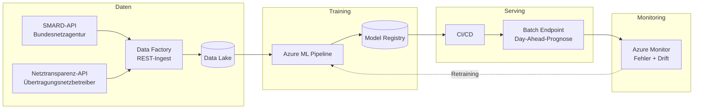

# Architekturentwurf: [Teamname]

Stand: [Datum], Version 0.1 (wird jede Woche aktualisiert)

## Überblick

Die vier Schichten von Tag 3: Daten, Training, Serving, Monitoring. Passen Sie das Diagramm an Ihren Use Case an. Es rendert in GitHub, GitLab und VS Code
(Erweiterung "Markdown Preview Mermaid Support"). Alternativ zeichnen Sie in draw.io oder Excalidraw
und legen das Bild hier ab.

## Bausteine

## Bausteine

| Baustein                 | Unser Werkzeug                                                                                             | Kommt an Tag | Offene Fragen                                                    |
| ---                      | ---                                                                                                        | ---          | ---                                                              |
| Datenquelle              | SMARD (Bundesnetzagentur): historische Stromverbrauchsdaten                                                | 21-24        | Auflösung und Zeitraum? Weitere Quellen (Feiertage, Wetter)?     |
| Aufnahme und Validierung | Historische Daten von SMARD laden; prüfen, ob alle Stundenwerte vorhanden und die Zeitstempel korrekt sind | 23, 24       | Umgang mit Lücken? Zeitumstellung (Tage mit 23 bzw. 25 Stunden)? |
| Feature Store            | Feast: bisheriger Stromverbrauch, Stunde, Wochentag                                                        | 21, 22       | Welche Lags? Reicht der Offline Store?                           |
| Trainingspipeline        | Täglich automatisch Daten laden, validieren, Features erstellen und das Modell bei Bedarf trainieren       | 15-20        | Airflow oder Kubeflow? Was heißt „bei Bedarf“?                   |
| Experiment Tracking      | MLflow: jeden Trainingslauf mit Parametern, Datensatzversion, RMSE und MAE dokumentieren                   | 6-8          | Welche Baseline?                                                 |
| Model Registry           | MLflow Registry: Modellversionen verwalten, bestes validiertes Modell freigeben                            | 7, 8         | Freigabekriterium? Automatisch oder manuell?                     |
| CI/CD                    | GitHub Actions                                                                                             | 13, 14       | Welche Tests und Gates?                                          |
| Laufzeitumgebung         | Docker-Images in Dev, Kubernetes in Prod                                                                   | 4, 27-29     | Wo läuft der Kubernetes-Cluster?                                 |
| Serving                  | Batch: Strombedarf für jede Stunde des nächsten Tages vorhersagen                                          | 26           | Wo werden die Prognosen abgelegt?                                |
| Monitoring               | Performance (RMSE/MAE, Prognose gegen Ist) und Concept Drift                                               | 33, 34       | Welches Werkzeug? Schwellwerte und Alerts?                       |

## Querschnittsthemen

| Thema                                | Unser Ansatz                                                           | Offene Fragen  |
| ---                                  | ---                                                                    | ---            |
| Versionierung von Code und Daten     | Git + PR-Review, DVC für Daten, MLflow für Läufe und Modelle           |                |
| Container und IaC                    | Docker-Images mit festen Tags, Kubernetes, Terraform                   |                |
| Security und Audit                   | OWASP DevSecOps Guideline, Audit-Trail (Git -> DVC -> MLflow -> Image) |                |

## Wichtige Entscheidungen

Jede wichtige Entscheidung bekommt einen ADR im Ordner `docs/adr/`. Liste:

- ADR-0001: [Titel]
