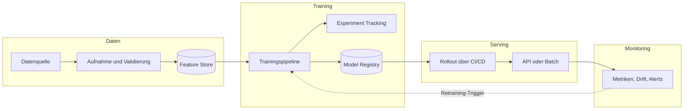

# Architekturentwurf: [Teamname]

Stand: [Datum], Version 0.1 (wird jede Woche aktualisiert)

## Überblick

Die vier Schichten von Tag 3: Daten, Training, Serving, Monitoring. Passen Sie das Diagramm an Ihren Use Case an. Es rendert in GitHub, GitLab und VS Code
(Erweiterung "Markdown Preview Mermaid Support"). Alternativ zeichnen Sie in draw.io oder Excalidraw
und legen das Bild hier ab.

## Bausteine

| Baustein                 | Unser Werkzeug | Kommt an Tag | Offene Fragen |
| ---                      | ---            | ---          | ---           |
| Datenquelle              |                | 21-24        |               |
| Aufnahme und Validierung |                | 23, 24       |               |
| Feature Store            |                | 21, 22       |               |
| Trainingspipeline        |                | 15-20        |               |
| Experiment Tracking      |                | 6-8          |               |
| Model Registry           |                | 7, 8         |               |
| CI/CD                    |                | 13, 14       |               |
| Laufzeitumgebung         |                | 4, 27-29     |               |
| Serving                  |                | 26           |               |
| Monitoring               |                | 33, 34       |               |

## Querschnittsthemen

| Thema                                | Unser Ansatz | Offene Fragen |
| ---                                  | ---          | ---           |
| Versionierung von Code und Daten     |              |               |
| Container und Infrastructure as Code |              |               |
| Security und Audit                   |              |               |

## Wichtige Entscheidungen

Jede wichtige Entscheidung bekommt einen ADR im Ordner `docs/adr/`. Liste:

- ADR-0001: [Titel]
