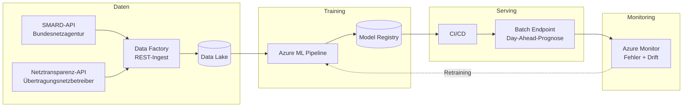

# Architekturentwurf: Shango

Stand: 2026-11-25, Version 0.1.2

## Überblick

Die vier Schichten von Tag 3: Daten, Training, Serving, Monitoring. Passen Sie das Diagramm an Ihren Use Case an. Es rendert in GitHub, GitLab und VS Code
(Erweiterung "Markdown Preview Mermaid Support"). Alternativ zeichnen Sie in draw.io oder Excalidraw
und legen das Bild hier ab.

## Bausteine

# MLOps-Bausteine – Strombedarfsprojekt

| Baustein                 | Unser Werkzeug                                                   | Kommt an Tag | Offene Fragen                                                                                    |
|---                       |---                                                               |---:          |---                                                                                               |
| Datenquelle              | SMARD, Python 3.14                                               | 21–24        | Welche Datenfelder, Merkmale und welcher Abrufzeitraum werden verwendet?                         |
| Aufnahme und Validierung | Python 3.14, Pandas                                              | 23, 24       | Wie prüfen wir fehlende Werte, Duplikate, Zeitstempel und Datenbereiche?                         |
| Feature Store            | Pandas DataFrame                                                 | 21, 22       | Reicht die Feature-Verarbeitung im DataFrame ?                                                   |
| Trainingspipeline        | Python, Pandas, scikit-learn                                     | 15–20        | Welche Schritte werden automatisiert und wie werden Daten- und Modellversionen festgehalten?     |
| Experiment Tracking      | MLflow                                                           | 6–8          | Welche Parameter, Metriken protokollieren wir?                                                   |
| Model Registry           | MLflow Model Registry                                            | 7, 8         | Nach welchen Kriterien wird ein Modell registriert und freigegeben?                              |
| CI/CD                    | GitHub Actions                                                   | 13, 14       | Welche Tests laufen automatisch und wie wird eine neue Version bereitgestellt?                   |
| Laufzeitumgebung         | Docker, Python                                                   | 4, 27–29     | Wie werden Abhängigkeiten und Python-Version reproduzierbar festgelegt?                          |
| Serving                  | Python Batch-Inferenz; optional AWS SageMaker AI Batch Transform | 26           | Wo wird der tägliche Batch-Job ausgeführt und wie werden die 24 Stundenprognosen bereitgestellt? |
| Monitoring               | Python Logging                                                   | 33, 34       | Wie überwachen wir Daten-Drift und Modellfehler, sobald Ist-Werte verfügbar sind?                |

## Querschnittsthemen

| Thema                                | Unser Ansatz                                                           | Offene Fragen  |
| ---                                  | ---                                                                    | ---            |
| Versionierung von Code und Daten     | Git + PR-Review, DVC für Daten, MLflow für Läufe und Modelle           |                |
| Container und IaC                    | Docker-Images mit festen Tags, Kubernetes, Terraform                   |                |
| Security und Audit                   | OWASP DevSecOps Guideline, Audit-Trail (Git -> DVC -> MLflow -> Image) |                |

## Wichtige Entscheidungen

Jede wichtige Entscheidung bekommt einen ADR im Ordner `docs/adr/`. Liste:

- ADR-0001: [Titel]
